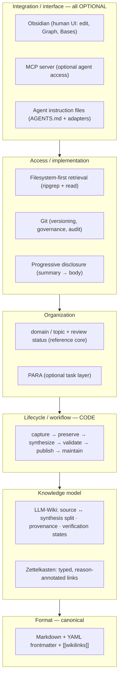

# Knowledge Repository Template — LLM Wiki & Second Brain

A **file-based, Markdown-native, source-grounded, graph-linked knowledge system with progressive disclosure and
Git-based governance** — usable at the same time by **humans** (optionally in Obsidian) and by **AI agents**
(Claude Code, Codex, and others), with **no application, service, database, or index required**.

Clone it to start a domain knowledge base (e.g. `laravel-knowledge`, `architecture-knowledge`). The template provides
the structure, conventions, workflows, and agent instructions; each domain repo holds its own knowledge.

> **New here?** [`OVERVIEW.md`](OVERVIEW.md) is a friendly, end-to-end guided tour (what it is, why it's shaped this
> way, what using it feels like). This README is the terse architecture intro; [`QUICKSTART.md`](QUICKSTART.md) gets you
> set up; [`AGENTS.md`](AGENTS.md) is the agent entry point.

## 1. What this is
A single repository that is both a human **Second Brain** and an agent-readable **LLM Wiki**, where every piece of
knowledge is plain Markdown + YAML under Git, cites its sources, and links to related knowledge.

## 2. The problem it solves
Teams accumulate knowledge in tools that lock it in, can't be read by agents, lose provenance, and blur the line
between a raw observation and verified fact. This template keeps knowledge in **portable files + Git** so it stays
readable by anyone and anything, records **where every claim comes from**, and keeps **observations separate from
verified knowledge**.

## 3. What it is **not**
- Not an app, CLI, database, search index, RAG/embeddings/vector store, or custom MCP server (none are shipped — see
  [`AGENTS.md` → "When the filesystem is not enough"](AGENTS.md)).
- Not tied to one AI vendor, IDE, or to Obsidian — all of those are optional.
- Not agent *session memory*. It is durable, reviewed, shared knowledge.

## 4. The architecture — layered (the patterns are not equivalent)
Each methodology/pattern owns **one layer**. They are **not** interchangeable architectures:



| Layer | Owns (what it decides) | Pattern(s) |
|---|---|---|
| **Knowledge model** | what knowledge *is* and how trusted | **LLM-Wiki** + **Zettelkasten** |
| **Lifecycle / workflow** | how knowledge is *produced & maintained* | **CODE** |
| **Organization** | how knowledge is *arranged* | **domain/topic + status**; **PARA** (optional task layer only) |
| **Format** | the canonical *encoding* | **Markdown + YAML + wikilinks** |
| **Access / implementation** | how it is *retrieved & versioned* | **filesystem-first + Git + progressive disclosure** |
| **Integration / interface** | human & agent *surfaces* (all optional) | **Obsidian · MCP · agent instruction files** |

CODE defines *workflow*, LLM-Wiki+Zettelkasten define the *knowledge model*, domain/topic+PARA define *organization*,
and Markdown/Git/filesystem are *mechanisms*. Treating these as one flat menu of "architectures" is the mistake this
layering avoids.

## 5. Methodologies & who owns what
See [`meta/methodology/methodologies.md`](meta/methodology/methodologies.md). In short: **CODE** → lifecycle;
**LLM-Wiki** → provenance, synthesis discipline, verification; **Zettelkasten** → reason-annotated typed linking (and
atomicity *where it helps*); **PARA** → an optional task layer, never the reference core.

## 6. How knowledge is stored & connected
- **Three content classes** (differently trusted): `inbox/` (capture) · `sources/` (preserved originals, provenance) ·
  `notes/` (synthesized wiki). See [`meta/methodology/lifecycle.md`](meta/methodology/lifecycle.md).
- **Portable YAML frontmatter** with three independent dimensions — **type**, **review status** (type-scoped), and
  **location** (the folder). See [`meta/methodology/metadata.md`](meta/methodology/metadata.md).
- **Claim-level provenance:** each `sources:` entry ties a claim to an external `url` or a local `ref` into `sources/`.
- **Typed, reason-annotated links** (`related:`) with canonical directions + derived inverses; see
  [`meta/methodology/relationships.md`](meta/methodology/relationships.md). Choose a note type with
  [`note-types.md`](meta/methodology/note-types.md).

## 7. How an AI agent interacts (filesystem-first)
Agents read [`AGENTS.md`](AGENTS.md) and work with ordinary file/search/`git` tools — **no Obsidian, no MCP required**:
search with `ripgrep`, read progressively (summary → body), traverse links, and contribute via the structured
[intake loop](meta/workflows/intake.md) over three **proportional** paths —
[quick-capture](meta/workflows/quick-capture.md), [source-preservation](meta/workflows/source-preservation.md),
[knowledge-synthesis](meta/workflows/knowledge-synthesis.md) — then propose changes as Git diffs. Retrieval protocol:
[`meta/workflows/retrieval.md`](meta/workflows/retrieval.md). For guided help there's an optional
[specialist](meta/specialist.md) (Obsidian / MCP / intake / retrieval).

## 8. Why it is agent-agnostic (honestly)
Interoperability has four levels (full detail + a verified support matrix in
[`meta/interoperability.md`](meta/interoperability.md)):
1. **Filesystem (universal guarantee):** any agent that can read files can use the repo.
2. **Instruction discovery:** `AGENTS.md` is read natively by some agents, conditionally by others — so we ship two
   **optional** adapters (`CLAUDE.md` = `@AGENTS.md`; `.gemini/settings.json`). **We do not claim universal
   compatibility.**
3. **Agent Skills (`SKILL.md`):** documented as an optional pattern; **no skills shipped**.
4. **Optional integrations:** Obsidian, MCP.

## 9. Obsidian (optional, for humans)
The vault is just this folder; everything Obsidian shows is derived from the files. It adds editing, Graph, Bases
dashboards, and search for **humans** — agents never need it. See [`meta/obsidian.md`](meta/obsidian.md).

## 10. MCP (optional, for agents, while Obsidian is open)
The Obsidian Local REST API plugin can expose read/search tools over MCP — a convenience, not a dependency (it offers
no semantic search and is unavailable when Obsidian is closed). See [`meta/mcp-setup.md`](meta/mcp-setup.md).

## 11. Instantiate the template for a new domain
**New here? Follow [`QUICKSTART.md`](QUICKSTART.md)** for the end-to-end setup (domain → Obsidian → MCP → feed → review).
In short:
1. Clone/copy into `<domain>-knowledge`. 2. Pick your `domain:` value. 3. (Optional) open in Obsidian; (optional) set
up MCP. 4. Add material to [`inbox/`](inbox/) and preserve originals into [`sources/`](sources/). 5. Ingest via the
[workflows](meta/workflows/). 6. Extend metadata/templates **additively**. 7. Maintain & version — update notes rather
than duplicating; Git keeps the history.

## 12. The knowledge lifecycle
`capture → ingest → classify → synthesize → relate → validate → publish → retrieve → maintain`, expressed as auditable
**review states** that keep observations separate from verified knowledge. An **agent observation never auto-becomes
verified** — a human verifies. See [`meta/methodology/lifecycle.md`](meta/methodology/lifecycle.md).

## 13. Git + human review protect quality
Agents propose on branches; **canonical knowledge enters `main` only through human-reviewed Git diffs**; `verified`
(and ADR `accepted`) are human-only states confirmed in review against the
[validation checklist](meta/workflows/validation-checklist.md). Git is the audit, rollback, and governance of record.
See [`meta/workflows/git-governance.md`](meta/workflows/git-governance.md).

## Layout
```
.
├── README.md            ← this file (architecture intro)
├── AGENTS.md            ← canonical agent entry point (filesystem-first)
├── CLAUDE.md            ← optional adapter: body is `@AGENTS.md` (import, not duplication)
├── .gemini/settings.json← optional adapter: points Gemini CLI at AGENTS.md
├── inbox/               ← quick capture (unprocessed, never cited)
├── sources/             ← preserved originals + provenance (conventionally immutable)
├── notes/               ← the wiki: synthesized concept/pattern/decision/reference notes
└── meta/                ← everything about the repo (methodology, workflows, templates, interoperability, integrations)
```
An optional PARA task layer (`projects/`, `areas/`) is described in
[`meta/methodology/methodologies.md`](meta/methodology/methodologies.md); create it only if your domain tracks work.
